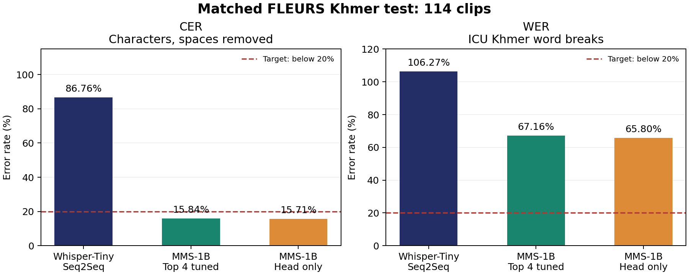
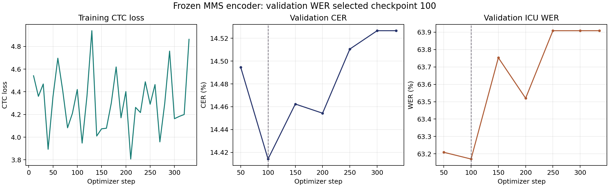
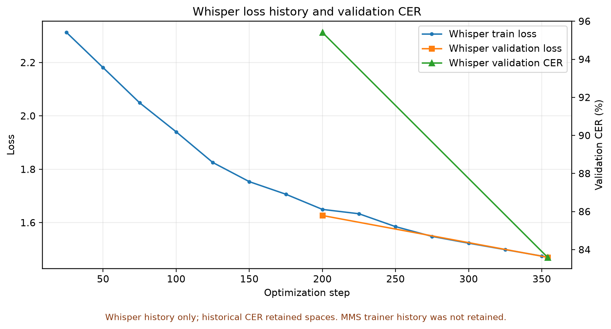
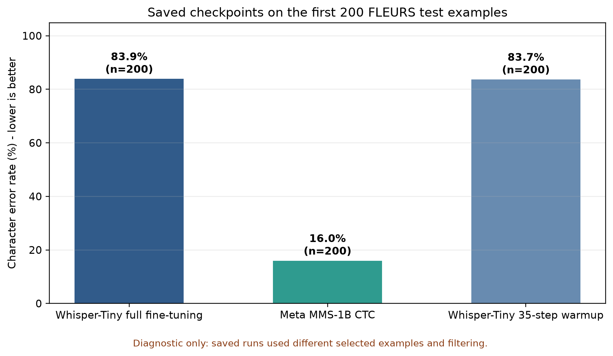
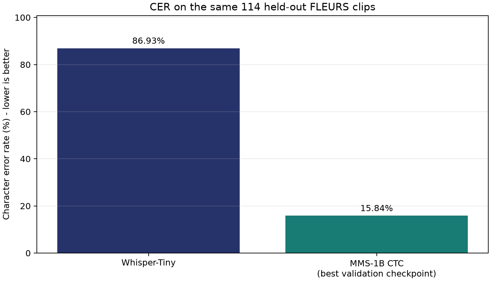
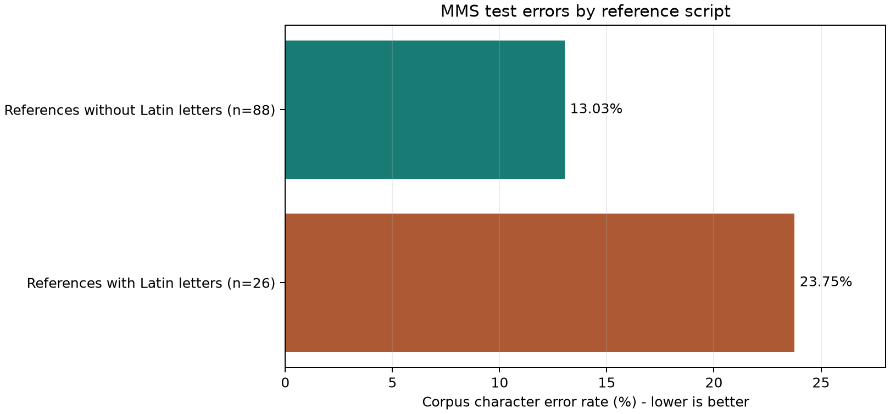
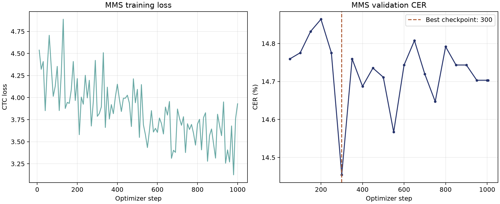

# Khmer Automatic Speech Recognition

Individual Deep Learning final project comparing Whisper-Tiny, Meta MMS-1B CTC, and a Qwen3-ASR 0.6B LoRA adapter on Khmer speech.

**Course:** Deep Learning Final Project, 2026-2027  
**Lecturer:** Mr. Soklong HIM  
**Student:** Khemrak Pasey

> **Experiment status:** The presentation compares three saved checkpoints on the same 114 held-out FLEURS clips: Whisper-Tiny, top-four-layer MMS-1B, and a Qwen3-ASR LoRA adapter trained on 16,720 effective clips. Qwen epoch 1 was selected on 124 validation clips at **12.42% CER / 27.99% WER**. Its one-time held-out evaluation scored **13.71% CER / 33.40% ICU WER**. The **validation WER <25%** goal remains unmet. Qwen used substantially more training data, so the test comparison does not isolate model architecture.

## Problem

Given a 16 kHz Khmer speech waveform, predict its Khmer Unicode transcript. The final comparison reports both character error rate (CER) and word error rate (WER) on the same held-out clips. Khmer spaces mainly mark phrase boundaries, so WER uses ICU's Khmer word-break dictionary on both references and predictions. Lower error rates are better. The metric policy and exact edit counts are saved in `results/matched_cer_wer_three_approaches.json`.

## Recent Qwen experiments

### Follow-up runs and audits (October 9–15)

The second downloaded archive (`selected_adapter_and_results(1).zip`) stopped
normally after epoch 3 because validation WER failed to improve twice. Its best
epoch 1 scored 12.60% CER / 29.26% WER; epoch 3 scored 30.84% WER. Reproducible
error analysis is in `src/audit_qwen_validation_errors.py`, with results in
`results/diagnostic/qwen_error_audit_20261009.json`. No listening judgments have
been fabricated; `notebooks/qwen_listening_review.ipynb` provides 12 difficult
validation clips for human review, without modifying references.

A pinned `seanghay/w2v-bert-2.0-khmer` alternative completed the fixed 24-clip
validation pilot at 21.11% CER / 89.06% WER. It is not being promoted to training.
See `results/diagnostic/w2vbert_pilot_20261009.json`.

The next unmeasured experiment is `notebooks/qwen_public_data_colab.ipynb`,
uploaded to https://colab.research.google.com/drive/1jbdT16QUCrB4YcutBYw2CtSifk-PIRd8 .
It supplements the original training data with up to 3,000 OpenSLR42 clips;
the actual retained count and hours are measured at runtime. It retains fixed
validation and scoring, uses a new output directory, rank16 attention LoRA,
learning rate 1e-5, at most three epochs, and patience1. Training runs only in Colab.
No result under 20% has been demonstrated.

The October 12 follow-up notebook, [`notebooks/qwen_public_data_target25_colab.ipynb`](notebooks/qwen_public_data_target25_colab.ipynb), completed three epochs in Colab using 2,798 retained OpenSLR42 clips (3.81 hours) plus the FLEURS training clips. It checks **CER <20% and ICU Khmer WER <25%** on the fixed 124-clip validation set. Its first cell checks for an attached NVIDIA GPU before downloading packages. The best checkpoint was epoch 3: **12.91% CER / 30.31% WER**, or 809 word edits over 2,669 reference words. The strict 25% goal allows at most 667 edits. This supplement did not improve on the earlier 28.81% WER student run. The final results cell was made self-contained for fresh Colab sessions and exported the epoch 3 adapter and evidence to `selected_adapter_and_results.zip` in its Drive run folder. Test audio remains unused during model selection.

The larger public-corpus run in `notebooks/qwen_km_corpus_bigtrain_colab.ipynb` completed three epochs with 16,720 effective training clips. Epoch 1 had the lowest full validation WER: **12.42% CER / 27.99% WER**. Its selected adapter was downloaded to `models/qwen_km_corpus_bigtrain_20261014_epoch1`. The [training configuration, three-epoch history, and validation predictions](results/diagnostic/qwen_bigtrain_epoch1_evidence/) are retained without model weights. After selection, local RTX 4050 BF16 inference on the fixed 114 FLEURS held-out clips scored **13.71% CER / 33.40% ICU WER** (1,629 character edits over 11,886 characters; 831 word edits over 2,488 words). The exact public-test predictions and configuration are in `results/diagnostic/qwen_bigtrain_heldout_epoch1_20261015.json`. Local demo transcriptions remain outside Git. Reproduce the held-out evaluation with `src/evaluate_qwen_bigtrain_local.py` through `src/run_qwen_wsl.sh`.

`src/prepare_openslr42.py` filters invalid/long/clipped audio and within-source
audio/transcript duplicates. One-way hashes of all official FLEURS validation
and test transcripts exclude exact external-training matches; test audio and
predictions are not used. Near duplicates remain a limitation. OpenSLR42 is
Google's manually quality-checked Khmer multi-speaker TTS recording corpus,
licensed CC BY-SA4.0; retain attribution and see https://www.openslr.org/42/ .
Its male-speaker archive does not by itself provide balanced speaker coverage.
Synthetic fixture checks verified overlap exclusion, duplicate/clipping rejection,
and resampling to 16kHz. The completed Colab run used a T4 GPU.

The downloaded `selected_adapter_and_results.zip` completed two epochs. Recomputed
ICU 77.1 scores for its selected epoch 1 are **12.66% CER / 28.92% WER** on the
fixed 124 validation clips; epoch 2 has 29.19% WER. The target remains unmet and
that OpenSLR42 adapter was not evaluated on the test set. Evidence is recorded in
`results/diagnostic/qwen_colab_v1_review_20261008.json`.

An additional proposed experiment is `notebooks/qwen_improve_colab_v2.ipynb`.
Upload this file to Colab, select a GPU, and run its cells in order. It starts
from the same pinned base with rank-16 attention LoRA, learning rate 5e-5,
at most four epochs, and patience two on the same validation WER. It uses a
separate Drive output directory and exports the best validation checkpoint.
Setup bootstraps pip through the host interpreter and displays installation
progress. T4 uses FP32; native BF16 support is checked without emulation.
This is a proposed experiment, not a demonstrated result below 20%.

## Data

The project uses the public Google FLEURS `km_kh` configuration from [Hugging Face Datasets](https://huggingface.co/datasets/google/fleurs). The dataset card identifies the FLEURS source and licensing terms. The downloaded version in this workspace contains 1,675 training, 326 validation, and 771 test examples. FLEURS supplies official splits; no speaker-level or class distribution applies to this transcription task. Audio is mono at 16 kHz. Known limits include the small amount of Khmer speech relative to high-resource languages and variation in speaker, recording, and topic.

The original Whisper run did not save its exact selected row indices. Its trainer state records 354 updates over three epochs with batch size 8, consistent with 941 usable training rows. Applying its documented label filter to a seed-42 shuffled 1,000-row FLEURS selection leaves exactly 941 rows. Its validation throughput similarly matches 189 retained rows from the first 200. These are strong inferences, not a preserved split manifest. The saved MMS training code selected the first 1,000 training rows without shuffling and removed clips over 10 seconds; its actual retained row count and training history were not saved. The two runs therefore cannot be treated as trained on the same examples.

## Approaches

| Approach | Architecture | Saved training strategy |
|---|---|---|
| Whisper-Tiny | Encoder-decoder Transformer with cross-attention | Full fine-tuning |
| Meta MMS-1B Khmer, top four tuned | Wav2Vec 2.0 encoder with CTC output | Top four Transformer layers plus CTC head/adapter trained; SpecAugment enabled |
| Meta MMS-1B Khmer, head only | Same Wav2Vec 2.0 encoder and CTC architecture | Encoder/adapter frozen; only the 194,712-parameter CTC head trained; SpecAugment enabled |

The top-four MMS run is **not adapter-only tuning**. Its saved model contains about 964.8M parameters, with approximately 79.1M trainable. The third approach changes the training strategy, not the architecture: its MMS encoder stays frozen and only the CTC head trains. The frozen-encoder Whisper ablation is excluded because this workspace has no saved checkpoint or evaluation metrics for it.

The original Whisper training arguments show 3 epochs, learning rate `1e-5`, 500 warmup steps, batch size 8, and gradient accumulation 1. It ended after 354 updates, before warmup finished. The MMS arguments show 15 epochs, learning rate `5e-5`, 50 warmup steps, batch size 1, and gradient accumulation 8. A separate Whisper rerun with 35 warmup steps is documented below. The repository still does not retain a learning-rate and regularization sweep.

## Final controlled comparison

All three approaches used the same saved 531/124/114 FLEURS train/validation/test manifest. CER uses NFC text with U+200B/U+FEFF and whitespace removed. WER uses NFC text, removes U+200B/U+FEFF, applies [ICU `km_KH` dictionary word breaks](https://unicode-org.github.io/icu/userguide/boundaryanalysis/), and excludes punctuation-only segments. The same policy is applied to all three models. The previously logged raw whitespace WER for Whisper is not comparable to this Khmer-segmented WER.

| Fine-tuned approach | Held-out test clips | Test CER | Khmer-segmented test WER |
|---|---:|---:|---:|
| Whisper-Tiny encoder-decoder | 114 | 86.76% | 106.27% |
| Meta MMS-1B CTC, top four layers tuned | 114 | 15.84% | 67.16% |
| Meta MMS-1B CTC, head only trained | 114 | **15.71%** | **65.80%** |

Both rates divide edit operations by the reference length, measured in characters or ICU-segmented words. A WER above 100% is possible when a model inserts extra words. Whisper's earlier Trainer log reported 86.93% CER from decoded labels; the 86.76% above comes from rescoring its saved checkpoint against the same raw FLEURS references used for MMS. These are test-set error rates, not sentence accuracy or verified scores on personal recordings. Exact edit counts and prediction pairs are in [`results/`](results/README.md). Large checkpoints are linked below.

The lecturer evaluates both CER and WER and, according to the student's latest report, accepts a WER shortfall with an honest discussion of limitations. The MMS runs meet the original character threshold but miss the original word threshold. The top-four MMS checkpoint was selected by validation CER. Its old Trainer `eval_wer` used whitespace and is not the Khmer-segmented WER above. The frozen MMS run selected checkpoint 100 using validation ICU WER. Because training labels omit spaces, validation WER uses word breaks on decoded labels, while final test WER uses the original FLEURS references. Keep this distinction in mind when comparing their values.

### Completed third approach

The lecturer suggested a third approach. `notebooks/mms_frozen_third_approach.ipynb` completed a controlled **frozen MMS encoder + trained CTC head** run for five epochs on a Colab T4. Validation ICU WER selected checkpoint 100. On the shared 114 test clips it scored **15.71% CER and 65.80% WER**. Its differences from the top-four MMS run are small: paired bootstrap intervals for both improvements cross zero. See [`results/mms_frozen_error_analysis.md`](results/mms_frozen_error_analysis.md) and the saved learning curves. The shared [model weights](https://drive.google.com/drive/folders/19zNYqPtxSMh-A0LBSklbHrewHwiE2rmr) and [run evidence](https://drive.google.com/drive/folders/1gGlzfcmf_3QuJ3HBtxxiCguNblSfXXvy) are available to link viewers.

### Current Qwen improvement experiment

The **publisher-trained** [`seanghay/Qwen3-ASR-0.6B-Khmer`](https://huggingface.co/seanghay/Qwen3-ASR-0.6B-Khmer) scored **14.29% CER and 32.07% ICU Khmer WER** on the same 124 FLEURS **validation** clips. This is an external baseline for choosing a new training experiment, not a fourth student-trained result and not a held-out test score. On 33 references containing ASCII letters or digits, WER was 48.54%; on the other 91, it was 25.61%. This suggests attention to names, numbers, and script conventions, but it does not establish that text normalization alone would meet the target. See `results/diagnostic/qwen_public_validation_summary.json` for counts and the scoring policy.

`src/train_qwen_lora.py` and `notebooks/qwen_lora_finetune.ipynb` define separate **student-owned LoRA fine-tuning experiments**. The Qwen project's official fine-tuning helper is pinned by commit in the notebook. The first one-epoch T4 run used 531 training clips and scored **14.45% validation CER and 33.12% validation WER**, slightly worse than the recorded publisher checkpoint on both measures. See `results/diagnostic/qwen_lora_validation_v1.json`. A local replication saved weights outside Git because the Colab Drive mount failed.

The expanded run finished locally on **September 26**: 883 official training clips of at most 15 seconds, learning rate `5e-5`, and the same 124 validation clips. Epoch 1 scored **14.52% CER / 32.26% WER**; epoch 2 scored **15.08% CER / 34.02% WER** while mean training loss fell from 0.2112 to 0.1567. This pattern is consistent with overfitting. Epoch 1 is best within this run, but neither epoch beats the recorded publisher baseline. Baseline and adapter were measured on different GPU types, so the small baseline difference is not evidence of a statistically established effect. This is a separate data-size experiment, not part of the original matched-training-size comparison.

**Decision: stop adding epochs to this recipe.** Both epoch checkpoints remain in `models/qwen_lora_expanded_local_v2/` (excluded from Git); configuration, metrics, public validation predictions, adapter hashes, and error breakdowns are in [`results/diagnostic/qwen_lora_expanded_v2.json`](results/diagnostic/qwen_lora_expanded_v2.json). Rescoring reproduces the saved metrics. Epoch 1 has 529 word substitutions, 100 deletions, and 232 insertions. WER is 47.87% on 33 references with ASCII letters or digits and 26.13% on the other 91. These groups do not isolate the cause of an error, and both miss the word threshold. No personal recording text is included.

Before another run, audit training audio/transcript alignment and the handling of names, numbers, and Khmer spelling; then choose one justified training change. Keep the evaluation policy fixed. The final partial gradient accumulation group was underweighted in the historical runs; future code corrects its divisor, without changing their recorded results. Epoch folders contain adapters, not full optimizer/RNG state for exact training resumption. These earlier Qwen adapters were not evaluated on the held-out test. The later big-corpus adapter was selected on validation, evaluated once on the held-out test, and added to the presentation; the original **WER <20% target remains unmet**.

#### October 7 improvement run

**Colab training (October 8):** Upload [`notebooks/qwen_improve_colab.ipynb`](notebooks/qwen_improve_colab.ipynb) to Google Colab, select a GPU runtime, then run all cells and mount Drive. This standalone notebook includes the source and fixed split, installs an isolated runtime, checks ICU 77.1 against saved predictions, and runs a new rank-16 attention LoRA experiment at `5e-6` on 1,663 clips. It supports T4 with FP32 and newer GPUs with BF16. Checkpoints and logs go to `MyDrive/khmer_asr_runs/qwen_attention_r16_colab_20261008`; rerunning resumes completed checkpoints with the same hardware/configuration. The selected adapter and validation evidence are exported as a ZIP. Reaching WER below 20% is an experimental target, not a guaranteed result. Training is intended for Colab; local use is for the demo and evaluation.

The data audit found 1,663 valid official training clips of at most 30 seconds (about 6.99 hours), with no audio-hash or normalized-transcript overlap with the fixed 124 validation clips. All 1,007 previously cached training/validation WAVs match the source recordings within PCM16 rounding. These checks verify files, signal validity, and split overlap; they do not establish that every spoken word matches its annotation. Audit evidence and the expanded row manifest are in `results/diagnostic/qwen_*20261007.json`.

The fixed 24-clip validation pilot tested BF16 inference with unchanged ICU 77.1 scoring. Base-model WER was 35.09% with automatic greedy decoding, 33.77% with explicit Khmer greedy decoding, and 27.36% with explicit Khmer and three beams. The existing 883-clip epoch-1 student adapter scored 28.11% with three beams. These are **pilot scores**, not full validation or final test results. No pilot meets both requirements.

On all **124 validation clips**, three-beam base-model decoding scored 14.98% CER / 30.99% WER. One output repeated a sentence until the generation limit. A general policy that retries unfinished beam outputs with greedy decoding corrected that failure: **12.58% CER / 28.40% WER** (1,567 character edits and 758 word edits). Completed beam outputs were retained exactly; the retry used only audio and model output, never a reference transcript. Both original and guarded predictions are saved in `results/diagnostic/qwen_base_bf16_*validation_20261007.json`. This is an external-model validation result; **the word threshold remains unmet**.

`src/train_qwen_candidate.py` completed the next student experiment: 1,663 clips, two epochs, rank-8 LoRA (1,662,976 trainable parameters), learning rate `1e-5`, cosine decay with 5% warmup, gradient accumulation 8, BF16, and gradient checkpointing. Full validation used three-beam Khmer decoding with the missing-end-token retry policy. Epoch 1 was selected at **12.49% CER / 28.81% WER** (1,555 character edits and 769 word edits); epoch 2 declined to 12.68% CER / 29.00% WER. Checkpoints include optimizer, scheduler, RNG state, experiment configuration, and a source snapshot. The held-out test remains unused because validation WER did not meet the target.

Windows Application Control currently blocks the native Windows PyTorch extension on this machine. A separate Ubuntu WSL Python 3.12 environment now provides CUDA inference; security settings are unchanged. Dependencies are recorded in `requirements-qwen-wsl.txt`. The existing Windows environment supplies the ICU 77.1 scorer through `src/run_qwen_wsl.sh`, so Linux's ICU version cannot silently change reported WER.

To launch the local demo using this environment, run `run_app_wsl.bat`. Its selector shows the chosen presentation models: the 16,720-clip Qwen3-ASR LoRA checkpoint, matched MMS-1B, and matched Whisper-Tiny. All three have scores on the fixed 114 held-out FLEURS clips, but Qwen used substantially more training data, so this is not a controlled training-data comparison. For an experiment from WSL, set `KHMER_HF_HOME` to the existing Windows Hugging Face cache, then use:

```bash
export KHMER_HF_HOME=/mnt/c/Users/ASUS/.cache/huggingface
bash src/run_qwen_wsl.sh src/train_qwen_candidate.py \
  --output-dir models/qwen_lora_train30_v3_guarded \
  --eval-beams 3 --eval-force-khmer
# To continue a saved run, add --resume models/qwen_lora_train30_v3_guarded/step-N
```

Use a new output directory for a different experiment. Training status and results must be taken from the saved checkpoint/history files; the command above alone does not establish a completed run or a passing score.





## Earlier diagnostic runs

All listed checkpoints were scored on the same first 200 examples of the FLEURS test split. CER applies NFC normalization, removes U+200B and U+FEFF, and removes whitespace before scoring. The 35-step-warmup Whisper rerun used the seed-42 shuffled first 1,000 training rows (941 retained after label filtering) and first 200 validation rows (189 retained).

| Approach | Trainable parameters | Training evidence | Epochs | Test CER (first 200) |
|---|---:|---|---:|---:|
| Original Whisper-Tiny | 37.8M | About 941 / 189 retained, inferred from run logs | 3 | **83.89%** |
| Whisper-Tiny, 35-step warmup rerun | 37.8M | 941 train / 189 validation retained | 3 | **83.67%** |
| Meta MMS-1B CTC, top four layers unfrozen | 79.1M | 1,000 train / 200 validation requested; retained counts unlogged | 15 | **15.96%** |

The Whisper rerun saved only 59 fewer character edits over 26,763 reference characters than the original: 22,392 versus 22,451. Among 200 clips, 92 improved, 84 worsened, and 24 tied. A paired utterance bootstrap interval for the CER improvement includes zero (`-0.49` to `+0.92` percentage points), so the observed `0.22`-point gain is too small to establish a reliable improvement. The result files retain both sets of Whisper predictions and the comparison details. MMS still has the much lower saved CER, while the differing training selections limit any architecture claim.

### Figures and learning-curve evidence





The original Whisper trainer state contains training loss and validation logs. Its historical validation CER retained spaces, while the post-hoc test CER removes whitespace; the two CER series therefore use different text policies. The warmup rerun's trainer state is saved in `results/diagnostic/whisper_warmup35_trainer_state.json`, with validation CER of 88.54%, 86.71%, and 83.62% after epochs one through three. MMS trainer history was not retained, so its learning curve cannot be reconstructed. The current figure shows the original Whisper history only.

`results/diagnostic/error_analysis.md` reports 13,424 substitutions, 8,741 deletions, and 286 insertions across the 200 Whisper examples, plus five high-error examples. Several outputs show repeated-token decoding failures. The report avoids assigning an acoustic cause without listening to each audio clip. MMS per-example predictions were not saved for this earlier run, so this diagnostic error analysis covers Whisper only.

## Training and evaluation

### Install

Use Python 3.10 or 3.11 with a CUDA GPU for training the MMS-1B model. Install the listed packages with:

```bash
pip install -r requirements.txt
```

The controlled reruns are complete. Use `notebooks/khmer_asr_experiments.ipynb` and `notebooks/mms_frozen_third_approach.ipynb` on a Google Colab GPU to reproduce them. The commands below prepare the same saved row list for all approaches. The historical scores above remain diagnostic.

### Matched rerun

```bash
# One shared list of eligible official FLEURS rows for both models.
python src/matched_fleurs.py --output results/matched_fleurs_split.json \
  --seed 42 --train-candidates 1000 --validation-candidates 200 \
  --test-start 200 --test-candidates 200 --max-duration-seconds 15

# Whisper-Tiny: train, validate, and test on the shared row list.
python src/finetune_whisper.py \
  --output-dir ./models/whisper-tiny-khmer-matched \
  --model-name openai/whisper-tiny --use-fleurs-train --skip-ddd \
  --split-manifest results/matched_fleurs_split.json \
  --metrics-output results/whisper_matched_metrics.json \
  --trainer-state-output results/whisper_matched_trainer_state.json \
  --seed 42 --num-train-epochs 3 --learning-rate 1e-5 --weight-decay 0 \
  --warmup-steps 35 --per-device-train-batch-size 1 \
  --per-device-eval-batch-size 4 --gradient-accumulation-steps 8 \
  --eval-steps 67 --save-steps 67 --fp16

# MMS CTC: use the identical row list and a new checkpoint folder.
python src/train_mms.py \
  --output-dir ./models/mms-khmer-ctc-matched \
  --model-id facebook/mms-1b-all --target-lang khm \
  --split-manifest results/matched_fleurs_split.json \
  --metrics-output results/mms_matched_metrics.json \
  --trainer-state-output results/mms_matched_trainer_state.json \
  --seed 42 --num-train-epochs 15 --learning-rate 3e-5 --weight-decay 0 \
  --unfreeze-top-layers 4 --apply-spec-augment --lr-scheduler-type cosine \
  --warmup-steps 50 --per-device-train-batch-size 1 \
  --per-device-eval-batch-size 1 --gradient-accumulation-steps 8 --fp16

# After both runs: save every prediction and create figures from the new evidence.
python src/evaluate_saved_whisper.py --model-dir models/whisper-tiny-khmer-matched \
  --split-manifest results/matched_fleurs_split.json \
  --output results/whisper_matched_predictions.json --device cuda
python src/evaluate_saved_mms.py --model-dir models/mms-khmer-ctc-matched \
  --processor-id facebook/mms-1b-all \
  --split-manifest results/matched_fleurs_split.json \
  --output results/mms_matched_best300_predictions.json --device cuda
# Compare both error rates from the saved predictions on the identical clips.
python src/score_matched_cer_wer.py \
  --whisper results/whisper_matched_predictions.json \
  --mms results/mms_matched_best300_predictions.json \
  --output results/matched_cer_wer_summary.json
python src/plot_cer_wer.py
python src/plot_matched_results.py --completed
```

The manifest removes recordings over 15 seconds and examples exceeding Whisper's label limit before either model trains. It records the exact retained indices. The new held-out test candidate rows start at index 200 because the earlier work repeatedly inspected rows 0–199. The matched output folders preserve the older local checkpoints. The Colab notebook includes three short MMS pilot runs: baseline, a lower learning rate, and weight decay. Pilot runs use validation only and save no large weights; the selected 3e-5 learning rate and zero weight decay went into the full MMS run. `--no-apply-spec-augment` is also available for a later regularization comparison. Final checkpoints and evidence are in Google Drive as shown in the notebook.

### Completed matched run: verified test evidence

The September 23–24 Colab run used one saved 531/124/114 train/validation/test manifest for two architectures. The manifest in `results/matched_fleurs_split.json` was regenerated locally and its train, validation, and test index hashes match the Drive copy exactly. Whisper-Tiny completed 3 epochs; its Trainer log reported 86.93% test CER. Rescoring the saved checkpoint against the shared raw references gave **86.76% CER and 106.27% WER**. The 15-epoch MMS run was interrupted at step 800, then resumed and completed at step 1005. Its best validation checkpoint remained step 300 (14.45% validation CER); it reached **15.84% test CER and 67.16% WER**. The final-step validation CER was 14.70%, so the extra training did not improve the selected model. The September 25 head-only MMS run used the same split, completed five epochs, selected checkpoint 100 by validation ICU WER, and reached **15.71% test CER and 65.80% WER**. None of these error rates is a percentage of fully correct sentences.

See `results/matched_cer_wer_three_approaches.json`, `results/mms_matched_best300_error_analysis.md`, and `results/mms_frozen_error_analysis.md` for exact counts and observed failure patterns. The 26 top-four MMS references containing Latin letters scored 23.75% corpus CER, versus 13.03% for the other 88; this is a descriptive failure breakdown. All three sets of 114 public FLEURS reference/prediction pairs are retained in this repository and Drive. To repeat MMS inference, use `src/evaluate_saved_mms.py` with `--processor-id facebook/mms-1b-all`, the saved checkpoint as `--model-dir`, and the shared split manifest. Both MMS strategies meet the reported character target on FLEURS, while none meets the word target under the stated segmentation policy.







These completed-run figures can be regenerated with `python src/plot_matched_results.py --completed`. The plotted history is a four-decimal copy of the full Trainer state in Drive. The Whisper trainer state also remains in Drive for a combined curve figure before submission.

### Private voice checks

Personal recordings and their outputs are kept outside Git. They do not have verified exact spoken references, so no accuracy percentage is claimed for them. For a private check, run `src/evaluate_saved_mms_user_audio.py` with `--audio-dir`, `--model-dir`, and `--output`; score only recordings with verified references using `src/score_user_audio.py`.

### Inference demo

Run `run_app_wsl.bat`, then open `http://127.0.0.1:7860`. The launcher uses the local Ubuntu WSL CUDA environment because Windows Application Control blocks the Windows PyTorch extension. When `models/qwen_km_corpus_bigtrain_20261014_epoch1/adapter_model.safetensors` is installed, the app defaults to the selected larger public-corpus Qwen adapter on the pinned Khmer base model. Otherwise, it prefers the installed 1,663-clip student adapter, then MMS. This optional Qwen path requires `qwen-asr` and `peft`. The dropdown also retains the older Qwen, MMS, and Whisper options; switching releases the previous model to fit GPU memory. Other clones need the appropriate weights first. Saved model files are ignored by Git. The demo listens only on localhost.

If Windows reports that Application Control blocked `_dynet` while importing Qwen, run `.venv\Scripts\python.exe src\fix_qwen_optional_import.py` once, then restart the app. This makes Qwen's Japanese alignment tokenizer load only when Japanese alignment is requested; Khmer transcription does not use it. The script backs up the original package file and does not change Windows security settings. Reapply it after reinstalling `qwen-asr==0.0.6`. The app also translates the Whisper checkpoints' Transformers 5 special-token configuration for the Transformers 4 runtime required by Qwen.

## Repository map

- `app.py`: Gradio inference interface supporting Whisper, MMS, and Qwen adapters.
- `src/`:
  - `src/finetune_whisper.py`: Whisper training and evaluation pipeline.
  - `src/train_mms.py`: MMS CTC training pipeline.
  - `src/train_qwen_candidate.py` / `src/train_qwen_lora.py`: Qwen LoRA fine-tuning workflows.
  - `src/matched_fleurs.py`: Generates the fixed FLEURS train/validation/test manifest.
  - `src/evaluate_saved_whisper.py`: Auditable Whisper evaluation on held-out test rows.
  - `src/evaluate_saved_mms.py`: Auditable MMS evaluation on held-out test rows.
  - `src/evaluate_qwen_bigtrain_local.py`: Local RTX BF16 held-out evaluation for the big-corpus Qwen adapter.
  - `src/score_matched_cer_wer.py`: Matched corpus CER and ICU Khmer-segmented WER calculation.
  - `src/probe_qwen_validation.py`: External Qwen baseline on validation clips.
  - `src/plot_cer_wer.py` / `src/plot_matched_results.py`: Figures and learning curve generators.
  - `src/analyze_third_approach.py`: Frozen MMS learning curves and paired comparison.
  - `src/evaluate_saved_mms_user_audio.py` / `src/score_user_audio.py`: Personal voice checks and scoring.
  - `src/run_app_wsl.sh` / `src/run_qwen_wsl.sh`: WSL CUDA environment launchers.
- `notebooks/`: Google Colab workflows for Whisper, MMS, and Qwen experiments.
- `results/`: Matched-run evidence, prediction JSONs, and diagnostic figures (`results/diagnostic/`).
- `slides/`: Current 13-slide KIT presentation (`Khmer_ASR_KIT_training_process_2026-10-20.pptx`, `.pdf`).
- `tools/`:
  - `tools/build_colab_demo.py`: Generates standalone live demo Colab notebook.
- `run_app.bat` / `run_app_wsl.bat`: Windows and WSL app launch scripts.

## Model weights

Large model files are excluded from Git by `.gitignore`. The top-four MMS score comes from checkpoint 300 in the [shared MMS Google Drive folder](https://drive.google.com/drive/folders/1gU93D2CA4lgn8E480GMy-UZhDzvstvJM); the [matched Whisper checkpoint](https://drive.google.com/drive/folders/1TOEafns7lSfMVkHpXhklCO_xSqZ_m9MZ) and [frozen MMS checkpoint](https://drive.google.com/drive/folders/19zNYqPtxSMh-A0LBSklbHrewHwiE2rmr) are shared separately. Link viewers have read access to all three folders and the [training evidence](https://drive.google.com/drive/folders/1gGlzfcmf_3QuJ3HBtxxiCguNblSfXXvy). The older diagnostic checkpoints are stored locally under `models/`. After training, Trainer loaded the best validation weights into each top-level Drive model folder with the processor files. To use the top-four MMS model in the app, download its top-level model and processor files into `models/mms-khmer-ctc-matched`; the `checkpoint-*` training-state subfolders are not needed for inference. Cloning this repository alone does not reproduce the saved-model demo. The app falls back to the public `facebook/mms-1b-all` base model if no local MMS folder exists. The older [Hugging Face Whisper page](https://huggingface.co/Seypa-47/whisper-tiny-khmer) returned HTTP 401 during this review; use the shared Drive folder for the matched Whisper weights.

## References

1. Radford, A. et al. (2023). *Robust Speech Recognition via Large-Scale Weak Supervision*. ICML.
2. Pratap, V. et al. (2023). *Scaling Speech Technology to 1,000+ Languages*. Meta AI Research.
3. Conneau, A. et al. (2023). *FLEURS: Few-shot Learning Evaluation of Universal Representations of Speech*. IEEE SLT.
4. Graves, A. et al. (2006). *Connectionist Temporal Classification: Labelling Unsegmented Sequence Data with Recurrent Neural Networks*. ICML.
5. Wolf, T. et al. (2020). *Transformers: State-of-the-Art Natural Language Processing*. EMNLP.

## AI assistance disclosure

**Tools used:** Antigravity AI Assistant and Codex AI assistant. **Scope:** project review, debugging support, evaluation/error-analysis code, and documentation/presentation edits. **Verification:** the student must personally verify the training runs, understand and be able to modify the submitted code, and add any other tools used. Training results are reported only when backed by saved logs or predictions.

## Submission readiness checklist

- [x] Topic approval: confirmed by the lecturer (per student).
- [x] Two distinct trained architectures and a third trained strategy are present.
- [x] Run all three approaches using the same train, validation, and test subsets; all runs completed.
- [x] Save training curves and trainer state for all three approaches; the frozen MMS state and both MMS curve figures are in this repository.
- [x] Retain prediction pairs and compute matched CER and Khmer-segmented WER for all three approaches.
- [x] Run and document MMS learning-rate and weight-decay pilot comparisons on validation data.
- [x] Share all three checkpoint folders and run evidence through viewer links.
- [x] Add the student name to the project materials.
- [x] README, requirements, source code, results, and slides are present.
- [x] Report the measured WER shortfall and its limitations; the lecturer reportedly accepts a well-explained shortfall.
- [x] Measure the separate Qwen public-data run: its best validation WER was 30.31%, so the <25% goal was not met; do not claim a test result from validation.
- [x] Measure the larger [Colab public-corpus run](https://colab.research.google.com/drive/1MbWz_v2ySKiiEW_mLrCoubanTyZOAr0z). It selected epoch 1 at 12.42% CER / 27.99% WER on validation; the fixed held-out evaluation scored 13.71% CER / 33.40% WER. The <25% validation WER goal was not met.
- [ ] Rehearse the 10-minute presentation/Q&A and confirm how the professor defines the above-80% target.
